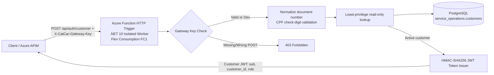

# CatCar - Auth Function (`catcar-auth-function`)

Serverless Azure Function responsible for customer authentication via CPF in the CatCar car repair shop management platform.

---

## Dedicated Serverless Authentication Architecture (Academic Cloud Consolidation)



The Function only authenticates active customer records. It normalizes the submitted CPF, rejects an invalid check digit before querying the database, uses the dedicated read-only connection for `service_operations.customers`, and issues a short-lived CatCar API JWT only after a successful lookup.

In Production (`catcar-prod`), the function runs on **Azure Functions Flex Consumption (`FC1`, 512 MiB, scale to zero)** and verifies origin APIM gateway keys on POST requests.

---

## API, OpenAPI & Postman

The Function publishes its own OpenAPI contract. It is independent from the
modular API contract exposed by `catcar-app`.

| Route | Method | Purpose |
|---|---|---|
| `/api/auth/customer` | `POST` | Validate a CPF/CNPJ and issue a customer JWT |
| `/api/auth/customer` | `OPTIONS` | CORS preflight |
| `/` | `GET` | Redirect to the generated Swagger UI |
| `/api/swagger/ui` | `GET` | Interactive Function Swagger UI |
| `/api/openapi/v3.json` | `GET` | Generated Function OpenAPI v3 document |

Local documentation:

- **Swagger UI:** [http://localhost:7071/api/swagger/ui](http://localhost:7071/api/swagger/ui)
- **OpenAPI v3 JSON:** [http://localhost:7071/api/openapi/v3.json](http://localhost:7071/api/openapi/v3.json)
- **Modular API Scalar:** [http://localhost:5000/docs](http://localhost:5000/docs) (documented separately by `catcar-app`)

Authenticate a customer directly against the local Function host:

```bash
curl --request POST http://localhost:7071/api/auth/customer \
  --header 'Content-Type: application/json' \
  --header 'X-Correlation-Id: 0198f2d2-7c16-7b1f-ae0c-4b2d7c1f9a40' \
  --data '{"documentNumber":"529.982.247-25"}'
```

The response includes the same `X-Correlation-Id` header. Invalid documents
return RFC 7807 Problem Details with status `400`; unknown customers return
`404`; inactive customers return `403`.

When testing the production routing boundary, submit the same request to the APIM base URL:

```bash
curl --request POST "$APIM_URL/api/auth/customer" \
  --header 'Content-Type: application/json' \
  --header "X-Correlation-Id: $(uuidgen)" \
  --data '{"documentNumber":"529.982.247-25"}'
```

- **Versioned Postman collection:** [`CatCar_Platform.postman_collection.json`](https://github.com/RiseOn-CatCar/catcar-platform/blob/main/docs/postman/CatCar_Platform.postman_collection.json)
- **Postman environment template:** [`CatCar_Platform.postman_environment.json`](https://github.com/RiseOn-CatCar/catcar-platform/blob/main/docs/postman/CatCar_Platform.postman_environment.json)

## Project Structure

```
.
├── infra/                          # Dedicated Terraform root for Flex Consumption Function App
│   ├── main.tf
│   ├── variables.tf
│   └── outputs.tf
├── src/
│   ├── CatCar.AuthFunction/        # Azure Function Isolated Worker HTTP endpoints
│   └── CatCar.ServiceDefaults/     # Shared OpenTelemetry & resilience extensions
├── tests/
│   └── CatCar.AuthFunction.Tests/  # Unit tests for authentication and JWT claims
├── CatCar.AuthFunction.slnx        # Solution manifest
├── Directory.Build.props           # Common MSBuild settings
├── Directory.Packages.props        # Central Package Management (CPM)
├── Dockerfile                      # Multi-stage container build (local/verification only)
└── .github/workflows/ci-cd.yml     # Automated CI/CD pipeline
```

---

## CI/CD Pipeline & Delivery Contract

- **Pull Requests / Pushes to `main`**: Runs build, unit test suite, and Terraform `infra/` formatting & validation.
- **Production Tag Push (`v*.*.*`)**: Appled `infra/` Terraform state `catcar-auth.tfstate`, publishes .NET 10 package, deploys to **Flex Consumption Function App** (`func-catcar-prod-<suffix>`), and smoke tests APIM customer auth route.
